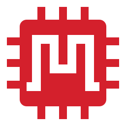
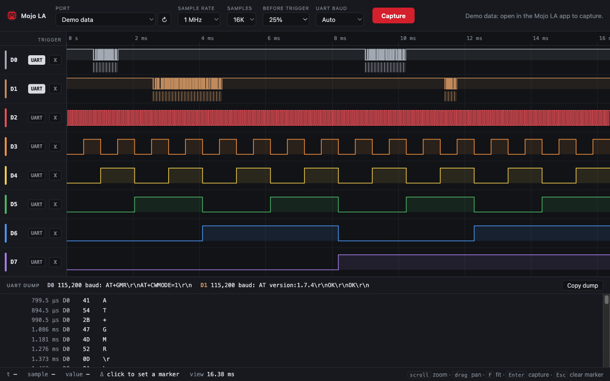
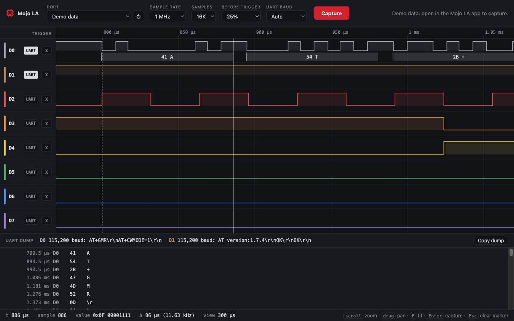

<p align="center">
  
</p>

<h1 align="center">Mojo Spartan-6 Projects</h1>

<p align="center">
  Verilog projects for the <b>Embedded Micro Mojo V3</b> FPGA board (Xilinx Spartan-6 XC6SLX9),<br>
  built and flashed from a Mac with no Windows or Linux machine in sight.
</p>

<p align="center">
  <a href="https://github.com/mralinp/mojo-spartan6-projects/actions/workflows/ci.yml"></a>
  <a href="https://github.com/mralinp/mojo-spartan6-projects/releases/latest"></a>
  
  
  
  
</p>

<p align="center">
  
  <br><sub>Mojo LA with its built-in demo data: an AT-command exchange on D0/D1, decoded as UART.</sub>
</p>

---

## Projects

| Project | What it does | Resources |
|---|---|---|
| [**logic_analyzer**](logic_analyzer/) | 8-channel, 200 MHz, 16K-sample logic analyzer. Speaks the SUMP protocol, so PulseView / sigrok work too. | 17% slices, 8 of 32 BRAMs, 1 PLL |
| [**viewer**](viewer/) | **Mojo LA**, a desktop app (Tauri + Rust) that captures from the logic analyzer, draws the waveforms and decodes UART. | macOS, Windows, Linux |
| [**led_counter**](led_counter/) | 8-bit binary counter on the onboard LEDs. The "hello world" that proves the toolchain works. | 1% slices |

## Quick start

```bash
tools/ise.sh build logic_analyzer                                   # Verilog -> bitstream (~3 min)
.venv/bin/python tools/mojo_load.py logic_analyzer/build/mojo_top.bin   # flash over USB (~13 s)
```

First time on a new Mac? See [Toolchain setup](#toolchain-setup) below.

## Download Mojo LA

Every merge to `main` publishes a release on the [Releases page](https://github.com/mralinp/mojo-spartan6-projects/releases/latest), each file with a `.sha256` next to it:

| OS | File |
|---|---|
| macOS (Apple silicon and Intel) | `Mojo-LA_<version>_universal.dmg` |
| Windows | `Mojo-LA_<version>_x64-setup.exe` or `.msi` |
| Linux | `.deb` or `.AppImage` |

The builds aren't code-signed. On macOS, right-click the app and choose **Open** the first time; on Windows, choose
**More info → Run anyway**. Bitstreams aren't in releases: ISE can't run in CI, so build them with `tools/ise.sh`.

## Logic analyzer

<table>
<tr><td>

| | |
|---|---|
| Channels | 8 |
| Max sample rate | 200 MHz (5 ns), from the Spartan-6 PLL; 100 MHz in PulseView |
| Memory | 16,384 samples |
| Trigger | pattern match (mask + value), pre/post-trigger split; holds off until the pre-trigger part is fresh |
| Protocol | SUMP / Openbench Logic Sniffer |
| Link | USB through the Mojo's AVR, 500 kbaud |

</td><td>

| Channel | Pin |
|---|---|
| 0 | P51 |
| 1 | P50 |
| 2 | P41 |
| 3 | P40 |
| 4 | P35 |
| 5 | P34 |
| 6 | P33 |
| 7 | P32 |

</td></tr>
</table>

> [!WARNING]
> Inputs are **3.3 V LVTTL and not 5 V tolerant**. Put a level shifter or divider in front of 5 V logic.

**Capture with Mojo LA**, the bundled desktop app:

```bash
cd viewer/src-tauri && cargo run --release
```

It works like an oscilloscope:

| Button | Key | What it does |
|---|---|---|
| **Auto** | `A` | Finds the busiest line and the level it rests at, measures its shortest pulse, picks the slowest sample rate with 10 samples per pulse, sets a trigger on that line leaving its rest level with 10% kept before it, and captures. |
| **Run** / **Stop** | `Space` | Captures again and again and redraws in place, keeping your zoom and marker. With a trigger set it waits for each one (Normal mode); without one it free-runs. |
| **Capture** | `Enter` | One capture (waits up to 20 s for the trigger). |

After every capture the view jumps to where the data begins: the trigger, or the first edge, through the end of
that first burst. With UART decoding on, that's the first message. `F` zooms out to the whole capture.

**Name your lines.** Click a channel's name (D0–D7) to rename it, say `TX`, `RX` or `SDA`, then press Enter (Esc
cancels, an empty name goes back to D0). The name shows everywhere, including the UART dump and copied logs, with the
original channel and its header pin underneath (`D0 · P51`), and it's remembered next time.

**Measure without counting.** The **Measurements** tab under the waveform lists every channel's edge count,
frequency and period (rising edge to rising edge), duty cycle, and the min / mean / max width of its high and low
pulses. Only whole pulses count. Choose *whole capture* or *visible window*; the window follows your zoom. For
anything else, click to drop marker A and Shift-click for marker B. Both snap to the nearest edge on the row you
click, and the footer shows the time between them and its frequency. Tests: `node viewer/ui/measure.test.js`.

To set things by hand, pick the sample rate, sample count and how much to keep before the trigger, and click a
channel's chip to trigger on it (`X` don't care → `0` → `1`). Scroll to zoom, drag to pan, click to drop a marker
and read the time and frequency to the cursor.

**Live is repeated captures, not a stream.** Everything goes through the Mojo's AVR at about 17 KB/s, so Run
refreshes about once a second with 16K samples and about 16 times a second with 1K. The app keeps the serial port
open while it runs: reopening it on every capture would toggle DTR, and five DTR drops within 250 ms put the Mojo's
AVR into its loader.

**Sniffing a UART:** wire the two lines to D0 and D1 and the grounds together; both channels decode as 8N1 UART
by default (toggle with each channel's **UART** chip). The baud rate is detected from the pulse widths, or pick it.
Bytes are labeled on the waveform, and the dump panel lists every byte with its time, hex and ASCII; click one to
jump to it, or **Copy dump** for a text log. Sample at 8× the baud rate or more: 1 MHz with 16K samples covers
16 ms, about 180 bytes at 115200. Decoder test: `node viewer/ui/uart.test.js`.

<p align="center">
  
  <br><sub>Zoomed in: each frame is boxed with its byte, and a marker measures one 10-bit frame (86 µs at 115,200 baud).</sub>
</p>

**I²C and SPI.** In the **Decoded** tab, **+ I²C** and **+ SPI** add a bus; pick its lines by channel name.
I²C shows start (`S`), repeated start (`Sr`) and stop (`P`), the 7-bit address with read/write, each byte, and
ACK/NACK; a NACKed address is flagged. SPI reads MOSI and MISO together in mode 0–3, MSB or LSB first, framed by
CS (optional). Bytes are boxed on the SDA / MOSI / MISO rows and listed with UART in time order. One capture records
all 8 channels at once, so UART, I²C and SPI can be decoded side by side; set the rate for the fastest bus. Buses
are remembered. Decoder tests: `node viewer/ui/buses.test.js`.

**Keep and share captures.** **Save** (⌘S) writes a `.mojola` file: the samples plus everything needed to
reopen it exactly as it was, including the sample rate, trigger point, time taken, channel names, UART chips and
I²C/SPI buses. **Open** (⌘O) brings it back. **Export** writes **VCD** (opens in GTKWave and PulseView, wires
named after your channels, 1 ns timescale) or **CSV** (time from the trigger in seconds, then one 0/1 column per
channel). Tests: `node viewer/ui/files.test.js`.

**Nothing seen is lost.** The **History** tab lists every capture, newest first: single captures, each live
frame, opened files and the demo. Each one shows a small preview of all 8 channels, when it was taken, its size and
its rate. Click one to view it again (live mode stops so it stays put). **☆ Pin** keeps a capture, even after
restarting the app; unpinned ones roll off after the newest 30. **Save** writes any of them as a `.mojola`.

**Compare against a reference.** In **History**, press **Compare** on a known-good capture to make it the
reference. It's drawn dashed over what's on screen, lined up on the trigger (or the first edge), and red bands mark
where the two disagree for longer than the **tolerance** you pick. The **Compare** tab lists, per channel, how many
spans differ and the longest, and which decoded bytes changed (`first #8: 31 vs 30`); click a row to jump to it.
It works live too: with **Run** on, every new frame is checked against the reference. Different sample rates line up
in time. Tests: `node viewer/ui/compare.test.js`.

`npx @tauri-apps/cli@2 build` in `viewer/src-tauri` makes a `.app` and `.dmg`. Opening `viewer/ui/index.html` in a
browser shows the viewer with demo data: AT commands on UART, an SSD1306 and a TMP102 on I²C, and a flash ID read
on SPI.

### Try it on a real UART: Arduino Pro Micro

[`examples/pro_micro_uart`](examples/pro_micro_uart/pro_micro_uart.ino) makes known traffic to capture. The Pro
Micro talks on `Serial1` to a USB-TTL dongle: it sends `tick N` every 100 ms and echoes back every line it receives.
The Mojo taps both wires.

| From | To |
|---|---|
| Dongle TX | Pro Micro **RXI** |
| Dongle RX | Pro Micro **TXO** |
| Mojo **D0** (P51) | Pro Micro **TXO** |
| Mojo **D1** (P50) | Pro Micro **RXI** |
| Mojo GND, dongle GND | Pro Micro GND |

> [!WARNING]
> The 5 V / 16 MHz Pro Micro drives 5 V on TXO, and the dongle may drive 5 V on RXI. The Mojo takes **3.3 V only**.
> Use the 3.3 V / 8 MHz Pro Micro with the dongle set to 3.3 V, or put a divider on each probe line
> (1 kΩ in series, 2 kΩ to GND gives 3.3 V from 5 V).

**Upload** with the board that matches yours: picking the wrong clock speed halves or doubles the baud rate.

```bash
arduino-cli compile --upload --fqbn arduino:avr:leonardo -p /dev/cu.usbmodemXXXX examples/pro_micro_uart  # 5 V / 16 MHz
```

For the 3.3 V / 8 MHz board, add SparkFun's board package and use `--fqbn SparkFun:avr:promicro:cpu=8MHzatmega32U4`.
On Apple silicon the Arduino AVR compiler is an Intel binary, so it needs Rosetta
(`softwareupdate --install-rosetta`); otherwise compiling fails with "bad CPU type in executable".

**Capture** in Mojo LA:

1. Pick the **Mojo's** port. The Pro Micro and the dongle show up as serial ports too.
2. Set 1 MHz and 16K samples, click D0's trigger chip to `0` and set *Before trigger* to 10%.
3. Press **Capture**. It waits for the next start bit on TXO and shows `tick N\r\n` decoded on D0.
4. To see the echo, set D1's trigger to `0` (and D0's back to `X`), press Capture, then send a whole line through
   the dongle. D1 shows your line, and D0 the echo right after it:
   ```bash
   .venv/bin/python -c "import serial; serial.Serial('/dev/cu.usbserial-XXXX', 115200).write(b'hello mojo\r\n')"
   ```

### Three buses at once: `pro_micro_buses`

[`examples/pro_micro_buses`](examples/pro_micro_buses/pro_micro_buses.ino) fills all 8 channels: the UART traffic
above, plus I²C (bit-banged, playing both the master and the devices, so you see ACKs, a display switched on at
`0x3C` and a TMP102 read as 25.5 °C at `0x48`) and SPI (a flash JEDEC-ID read, `9F 00 00 00`). It repeats every
200 ms, so one 16 ms capture at 1 MHz triggered on D0 catches all three.

| Mojo | Pro Micro | Bus |
|---|---|---|
| D0 (P51) | TXO | UART |
| D1 (P50) | RXI | UART |
| D2 (P41) | 3 (SCL) | I²C |
| D3 (P40) | 2 (SDA) | I²C |
| D4 (P35) | 15 (SCK) | SPI |
| D5 (P34) | 16 (MOSI) | SPI |
| D6 (P33) | 14 (MISO) | SPI |
| D7 (P32) | 10 (CS) | SPI |

Same voltage rule as above: on a 5 V Pro Micro every one of these needs a divider. In Mojo LA, the default **+ I²C**
and **+ SPI** buses already match this wiring.

**Capture with PulseView:** pick the driver *Openbench Logic Sniffer & SUMP compatibles*, serial port
`/dev/cu.usbmodem*`, then *Scan for devices*. It shows up as **Mojo LA** with 8 channels.

**LEDs:** each edge on a probe lights its LED for 50 ms, so you can see which lines are talking (a busy UART looks
solidly lit) before you capture. Quiet lines stay dark whatever their level.

**From the command line:**

```bash
sigrok-cli -d ols:conn=/dev/cu.usbmodem1201 --config samplerate=1m --samples 16k -o capture.sr
```

**Simulate** (needs `brew install icarus-verilog`): the testbench plays the host, checks the ID reply and a triggered
capture.

```bash
cd logic_analyzer && iverilog -o /tmp/tb tb.v mojo_top.v && vvp /tmp/tb
```

## Toolchain setup

Spartan-6 is only supported by **Xilinx ISE 14.7**, which never shipped for macOS. Here it runs in an x86 Linux
container (emulated on Apple silicon), and a small Python loader replaces the Mojo IDE for flashing.

1. **Docker image** with ISE's runtime libraries:
   ```bash
   tools/ise.sh image
   ```
2. **ISE 14.7 WebPACK.** Download *Full Installer for Linux* (`Xilinx_ISE_DS_Lin_14.7_1015_1.tar`, 6.5 GB) from
   AMD, then install it into a Docker volume. The installer shows Xilinx's EULA for you to accept.
   ```bash
   tools/ise.sh install ~/Downloads/Xilinx_ISE_DS_Lin_14.7_1015_1.tar
   ```
3. **License.** Generate a free *ISE WebPACK* license on AMD's licensing site and save it as `tools/Xilinx.lic`
   (it's git-ignored). If your license is node-locked, use host ID `020000001407`: the container always runs with
   that MAC address.
4. **Loader:**
   ```bash
   python3 -m venv .venv && .venv/bin/pip install pyserial
   ```

## Things the Mojo taught me

Two quirks that cost real debugging time, written down so they don't cost it again:

- **Large USB writes wedge the AVR on modern macOS.** The bootloader acknowledges the command and size, then
  stops reading mid-transfer until the board is power-cycled. Writing the bitstream in 32-byte pieces fixes it, so
  `mojo_load.py` does exactly that.
- **200 MHz needs every path under 5 ns.** The PLL turns the 50 MHz crystal into 200 MHz for the whole design.
  The first build missed by 120 ps, so four slow paths are now registered: the trigger compare, the
  configuration-done flag, the sample counter's end check and the sample tick, each predicted a cycle ahead. The
  worst path is now 4.63 ns. A Pro Micro's UART bit measures 1,700 samples at 200 MHz: its real baud rate is
  117,647, as close to 115,200 as a 16 MHz AVR gets.
- **`avr_rx_busy` is a toggle, not a level.** The AVR firmware flips the line once per byte it has room for and
  freezes it when its buffer is nearly full. Treating it as a level deadlocks the FPGA; ignoring it drops a third of
  a 16K capture. The analyzer sends one byte per edge, and a full 16K capture now arrives intact in about a second.

## Contributing

Every change starts as an issue (Task or Bug form) and lands through a pull request:

1. Open an issue; labels say its type (`type/*`), area (`area/fpga`, `area/viewer`, `area/tooling`), priority (`P0`–`P3`) and hardware risk (`risk/*`).
2. Branch off `main` as `type/<issue>-slug`, e.g. `feature/7-spi-decoder`.
3. Commit in conventional style: `feat(viewer): decode SPI on any two channels`.
4. Open a PR that says `Closes #<issue>`; its title must be a Conventional Commit too, since it becomes the squash
   commit. CI runs the checks and builds Mojo LA on all three platforms.

**Versioning is automatic.** On every merge, CI reads the commits since the last tag: a `feat` bumps the minor
version, a `fix` or anything else the patch, and a `!` (like `feat!:`) or `BREAKING CHANGE` the major. It then tags
`vX.Y.Z`, builds the installers with that version and publishes the release with a changelog grouped by type.

## Layout

```
assets/logo.svg   the logo: a waveform M cut out of an FPGA chip
logic_analyzer/   mojo_top.v (design + UARTs), mojo.ucf (pins), tb.v (testbench)
led_counter/      mojo_top.v, mojo.ucf
examples/
  pro_micro_uart/ Arduino Pro Micro sketch: UART traffic to test the analyzer with
  pro_micro_buses/ UART + I²C + SPI at once, on all 8 channels
viewer/
  ui/index.html   the whole frontend: canvas waveform view, no framework
  src-tauri/      Rust side: serial port listing and SUMP capture
tools/
  ise.sh          image / install / build, all through Docker
  Dockerfile      ISE runtime libraries (Ubuntu 18.04, linux/amd64)
  mojo_load.py    USB flasher, same protocol as Embedded Micro's Mojo Loader
```

Each project is one folder with a `mojo_top.v` and a `mojo.ucf`. Copy `led_counter/` to start a new one.
